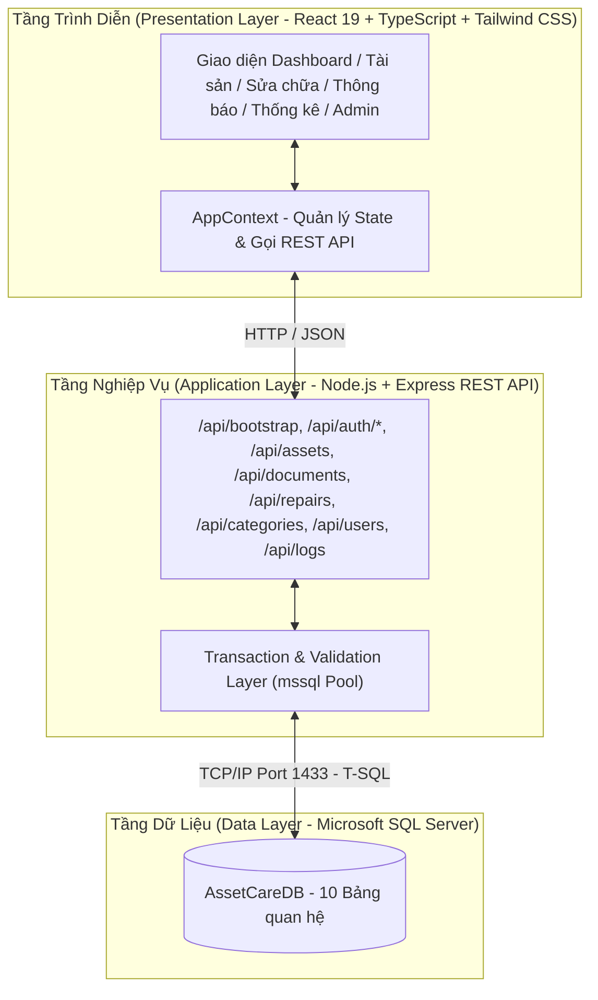
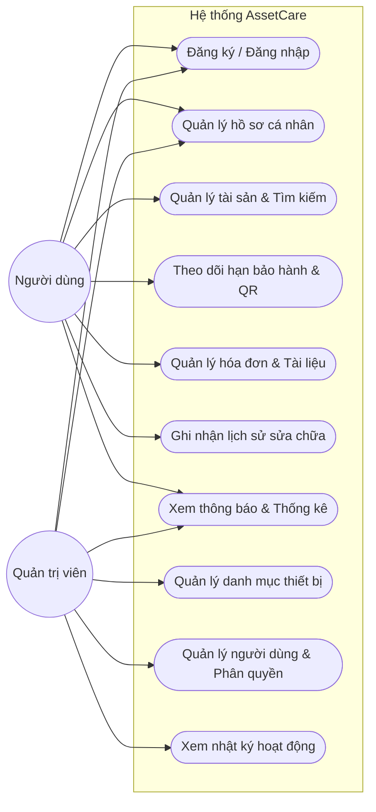
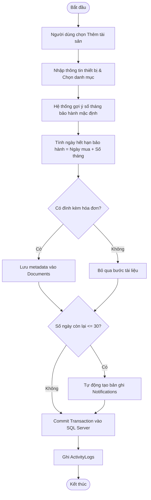
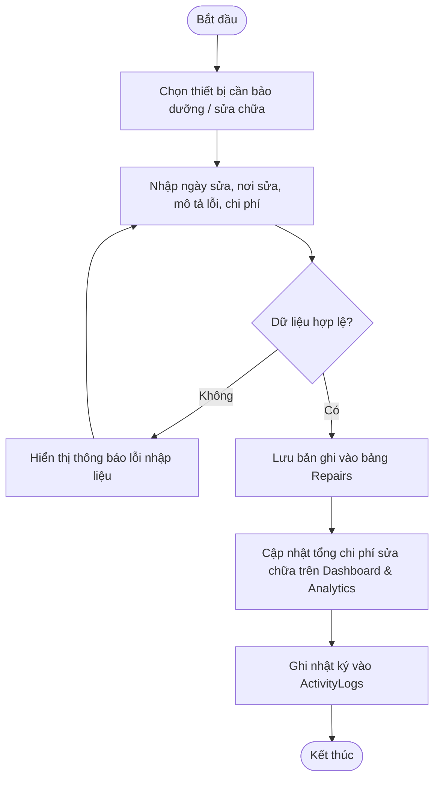
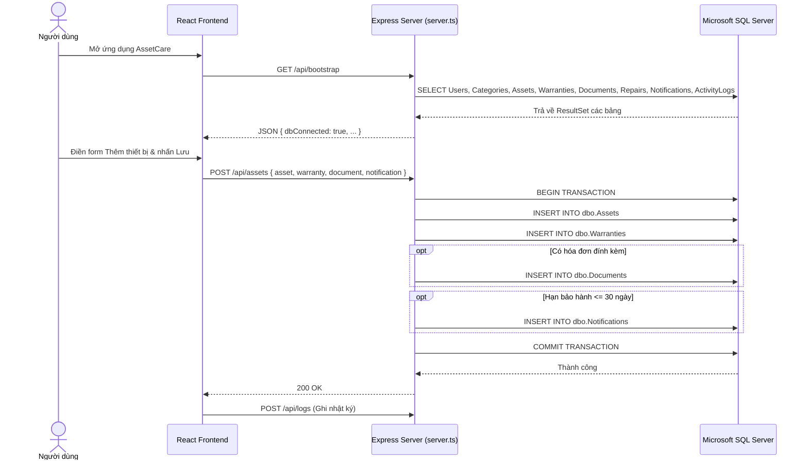
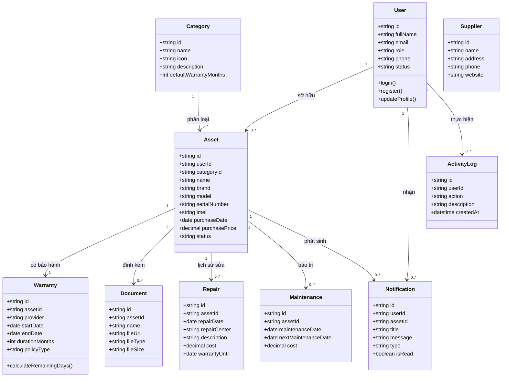
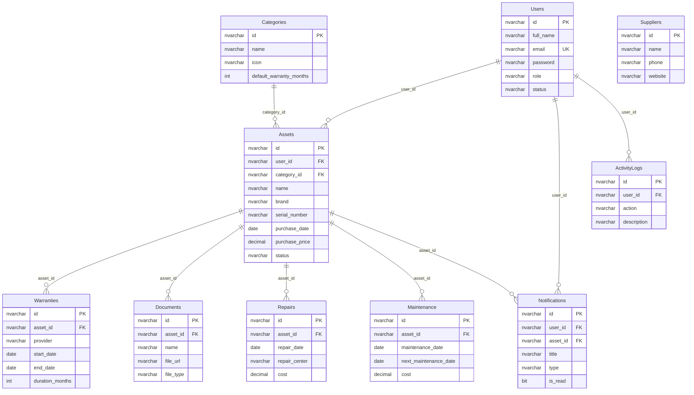

# TÀI LIỆU PHÂN TÍCH VÀ THIẾT KẾ HỆ THỐNG

**Tên đề tài:** Xây dựng ứng dụng web quản lý thiết bị điện tử và thời hạn bảo hành (**AssetCare**)  
**Học phần:** Đồ án Cơ sở 2  
**Sinh viên thực hiện:** Lê Trọng Nhân (`nhanlt.25gt@vku.udn.vn`)  
**Trường:** Đại học Công nghệ Thông tin và Truyền thông Việt – Hàn (VKU)  
**Công nghệ sử dụng:** React 19 + TypeScript + Tailwind CSS + Node.js / Express + Microsoft SQL Server  

---

## CHƯƠNG 1. TỔNG QUAN ĐỀ TÀI VÀ KHẢO SÁT BÀI TOÁN THỰC TẾ

### 1.1. Lý do chọn đề tài
Trong đời sống hiện đại, mỗi cá nhân và hộ gia đình sở hữu ngày càng nhiều thiết bị điện tử và gia dụng có giá trị cao (laptop, điện thoại thông minh, máy ảnh, đồng hồ thông minh, robot hút bụi, thiết bị âm thanh…). Thực tế phát sinh nhiều vấn đề khi quản lý theo phương pháp truyền thống:
1. **Thất lạc hóa đơn giấy và phiếu bảo hành:** Khi thiết bị phát sinh sự cố kỹ thuật, người dùng không tìm lại được hóa đơn VAT hoặc phiếu bảo hành bản giấy để xuất trình cho trung tâm bảo hành.
2. **Quên thời hạn bảo hành:** Không nắm được chính xác ngày hết hạn dẫn đến bỏ lỡ quyền lợi sửa chữa/đổi mới miễn phí trước khi hết hạn vài ngày hoặc vài tuần.
3. **Thiếu lịch sử bảo dưỡng và sửa chữa tập trung:** Không thống kê được thiết bị đã từng thay linh kiện gì, sửa ở đâu, tổng chi phí sửa chữa từ lúc mua đến hiện tại là bao nhiêu.
4. **Khó tra cứu thông số kỹ thuật và mã định danh:** Số Serial, IMEI, hotline hãng và chính sách bảo hành nằm rải rác trên nhiều hộp máy hoặc email khác nhau.

Từ bài toán thực tế đó, đề tài xây dựng hệ thống **AssetCare** nhằm số hóa toàn bộ vòng đời sở hữu thiết bị điện tử cá nhân từ lúc mua sắm, theo dõi bảo hành, lưu trữ tài liệu, cảnh báo sắp hết hạn đến ghi nhận lịch sử sửa chữa và thống kê chi phí.

### 1.2. Mục tiêu và phạm vi hệ thống
- **Mục tiêu chức năng:** Cung cấp công cụ quản lý tập trung danh sách thiết bị, tự động tính toán số ngày bảo hành còn lại, cảnh báo theo ngưỡng (60 ngày, 30 ngày, 7 ngày, quá hạn), lưu trữ hóa đơn/phiếu bảo hành số, quản lý lịch sử sửa chữa, tạo mã QR định danh thiết bị và phân tích chi phí sở hữu.
- **Đối tượng sử dụng:**
  - **Người dùng (User):** Quản lý toàn bộ thiết bị cá nhân, hóa đơn, bảo hành, sửa chữa và nhận thông báo nhắc hạn.
  - **Quản trị viên (Admin):** Quản lý danh mục thiết bị chuẩn, quản lý tài khoản người dùng, phân quyền RBAC và giám sát nhật ký hoạt động toàn hệ thống.

### 1.3. Quy trình nghiệp vụ tổng thể (System Process)
1. Người dùng đăng ký / đăng nhập vào hệ thống.
2. Thêm mới thiết bị (nhập thông tin định danh, danh mục, ngày mua, giá mua) kèm thông tin bảo hành (nhà cung cấp, số tháng bảo hành, ngày hết hạn tự động tính) và tải lên hóa đơn/phiếu bảo hành.
3. Hệ thống tự động đánh giá trạng thái bảo hành (`Còn hạn` / `Sắp hết hạn` / `Hết hạn`) và sinh thông báo cảnh báo nếu thiết bị nằm trong ngưỡng cảnh báo.
4. Trong quá trình sử dụng, người dùng cập nhật nhật ký sửa chữa, bảo trì định kỳ, xuất mã QR tra cứu nhanh và theo dõi báo cáo thống kê chi phí theo danh mục/thời gian.
5. Quản trị viên quản lý danh mục, người dùng và theo dõi nhật ký thao tác (`ActivityLogs`).

---

## CHƯƠNG 2. PHÂN TÍCH YÊU CẦU HỆ THỐNG

### 2.1. Yêu cầu chức năng (Functional Requirements)

| Mã | Tên chức năng | Tác nhân | Mô tả chi tiết |
| :--- | :--- | :--- | :--- |
| **FR01** | Đăng ký & Đăng nhập tài khoản | User, Admin | Cho phép tạo tài khoản mới, đăng nhập bằng email/mật khẩu, chuyển đổi vai trò người dùng. |
| **FR02** | Quản lý hồ sơ cá nhân | User, Admin | Cập nhật họ tên, số điện thoại, ảnh đại diện và thông tin liên hệ. |
| **FR03** | Quản lý danh sách thiết bị (CRUD) | User, Admin | Thêm, xem chi tiết, chỉnh sửa, xóa thiết bị; lưu Serial, IMEI, nơi mua, giá mua, ảnh thiết bị. |
| **FR04** | Tìm kiếm & Lọc thiết bị đa tiêu chí | User, Admin | Tìm theo tên, hãng, Serial/IMEI; lọc theo danh mục và trạng thái bảo hành. |
| **FR05** | Tính toán thời hạn bảo hành tự động | Hệ thống | Tự động tính ngày hết hạn từ ngày mua + số tháng bảo hành; tính % tiến độ và số ngày còn lại. |
| **FR06** | Hệ thống cảnh báo sắp hết hạn | Hệ thống, User | Phân loại cảnh báo theo mốc `<= 7 ngày` (khẩn cấp), `<= 30 ngày`, `<= 60 ngày`, quá hạn; đánh dấu đã đọc. |
| **FR07** | Lưu trữ hóa đơn & Phiếu bảo hành số | User | Upload, xem trước và xóa tài liệu đính kèm (Hóa đơn VAT, Phiếu bảo hành, Ảnh chụp, Sách HDSD). |
| **FR08** | Quản lý lịch sử sửa chữa & Chi phí | User | Ghi nhận ngày sửa, trung tâm sửa chữa, kỹ thuật viên, mô tả lỗi, chi phí (VNĐ), bảo hành sau sửa. |
| **FR09** | Tạo mã QR định danh thiết bị | User | Sinh mã QR chứa thông tin định danh và bảo hành để in dán hoặc quét nhanh bằng điện thoại. |
| **FR10** | Bảng điều khiển & Thống kê phân tích | User, Admin | Thống kê tổng tài sản, tổng giá trị đầu tư, tổng chi phí sửa chữa, biểu đồ phân bổ theo danh mục và trạng thái bảo hành. |
| **FR11** | Quản lý danh mục thiết bị | Admin | Thêm, chỉnh sửa, xóa danh mục thiết bị và cấu hình số tháng bảo hành mặc định theo từng loại. |
| **FR12** | Quản trị người dùng & Nhật ký hệ thống | Admin | Kích hoạt/khóa tài khoản, nâng/hạ quyền Admin–User, xem lịch sử thao tác `ActivityLogs`. |

### 2.2. Yêu cầu phi chức năng (Non-Functional Requirements)
- **Tính sẵn sàng & Kiến trúc 2 chế độ:** Hỗ trợ kết nối trực tiếp cơ sở dữ liệu Microsoft SQL Server thông qua Express REST API khi triển khai cục bộ, đồng thời có cơ chế dự phòng trạng thái phía client khi chạy bản xem trước độc lập.
- **Bảo mật & Phân quyền (RBAC):** Kiểm soát phạm vi dữ liệu theo `user_id`; người dùng chỉ xem và thao tác trên thiết bị của chính mình, quản trị viên có quyền giám sát toàn hệ thống và quản lý danh mục/tài khoản.
- **Toàn vẹn dữ liệu:** Sử dụng khóa ngoại (`FOREIGN KEY`), ràng buộc `CHECK`, `UNIQUE`, và giao dịch (`SQL Transaction`) khi tạo đồng thời thiết bị, thông tin bảo hành, tài liệu và thông báo.
- **Hiệu năng & Trải nghiệm người dùng:** Giao diện đáp ứng (Responsive) trên Desktop, Tablet, Mobile; hỗ trợ tiếng Việt đầy đủ (`NVARCHAR` Unicode trong SQL Server) và định dạng tiền tệ VNĐ.

---

## CHƯƠNG 3. THIẾT KẾ HỆ THỐNG

### 3.1. Kiến trúc hệ thống 3 tầng (3-Tier Architecture)



### 3.2. Sơ đồ Use Case tổng quát



### 3.3. Đặc tả một số Use Case chính

#### Use Case 1: Thêm thiết bị mới và thông tin bảo hành (UC3 & UC4)
- **Tác nhân chính:** Người dùng / Quản trị viên.
- **Tiền điều kiện:** Người dùng đã đăng nhập với trạng thái tài khoản `active`.
- **Luồng sự kiện chính:**
  1. Người dùng chọn chức năng **Thêm tài sản**.
  2. Hệ thống hiển thị biểu mẫu nhập thông tin thiết bị (tên, danh mục, hãng, model, Serial/IMEI, ngày mua, giá mua, nơi mua, ảnh) và thông tin bảo hành (nhà cung cấp, số tháng, chính sách, hotline).
  3. Hệ thống tự động gợi ý số tháng bảo hành mặc định theo danh mục và tính ngày hết hạn (`end_date`).
  4. Người dùng đính kèm hóa đơn/phiếu bảo hành (tùy chọn) và nhấn **Lưu**.
  5. Hệ thống mở một `Transaction` trong SQL Server: chèn bản ghi vào `Assets`, `Warranties`, `Documents` (nếu có) và tự động tạo `Notifications` nếu thiết bị còn `<= 30 ngày` bảo hành, đồng thời ghi `ActivityLogs`.
- **Hậu điều kiện:** Thiết bị xuất hiện trong danh sách và đồng bộ vào bảng thống kê, lịch sử hoạt động.

#### Use Case 2: Ghi nhận lịch sử sửa chữa thiết bị (UC6)
- **Tác nhân chính:** Người dùng.
- **Luồng sự kiện chính:**
  1. Người dùng chọn thiết bị cần ghi nhận sửa chữa và mở biểu mẫu **Thêm lịch sử sửa chữa**.
  2. Nhập ngày sửa, trung tâm sửa chữa, kỹ thuật viên, mô tả hạng mục sửa, chi phí (VNĐ) và hạn bảo hành sau sửa.
  3. Hệ thống lưu bản ghi vào bảng `Repairs`, cập nhật tổng chi phí sở hữu (TCO) và ghi nhận nhật ký hoạt động.

### 3.4. Sơ đồ hoạt động (Activity Diagrams)

#### 3.4.1. Quy trình Thêm thiết bị và Tự động cảnh báo bảo hành



#### 3.4.2. Quy trình Ghi nhận sửa chữa & Thống kê chi phí



### 3.5. Sơ đồ tuần tự (Sequence Diagrams)

#### 3.5.1. Tuần tự Khởi tạo dữ liệu và Thêm mới tài sản với SQL Server



### 3.6. Sơ đồ lớp đối tượng miền (Class Diagram)



### 3.7. Thiết kế Cơ sở dữ liệu (ERD & Đặc tả 10 bảng SQL Server)

Script khởi tạo đầy đủ nằm tại `database/AssetCare_SQLServer.sql` với tên cơ sở dữ liệu `AssetCareDB`.



---

## CHƯƠNG 4. HƯỚNG DẪN CÀI ĐẶT VÀ VẬN HÀNH TRÊN WINDOWS (SQL SERVER + INTELLIJ IDEA)

### 4.1. Khởi tạo cơ sở dữ liệu trên SQL Server Management Studio (SSMS)
1. Mở **Microsoft SQL Server Management Studio (SSMS)** và đăng nhập vào SQL Server cục bộ.
2. Mở tệp `database/AssetCare_SQLServer.sql` bằng **File -> Open -> File...**
3. Nhấn **Execute (F5)** để tạo cơ sở dữ liệu `AssetCareDB` gồm 10 bảng cùng toàn bộ dữ liệu mẫu.
4. Kiểm tra kết nối TCP/IP trong **SQL Server Configuration Manager**:
   - Vào **SQL Server Network Configuration -> Protocols for MSSQLSERVER** (hoặc `SQLEXPRESS`), bật **TCP/IP = Enabled**.
   - Trong mục **IP Addresses -> IPAll**, đặt **TCP Port = `1433`** và khởi động lại dịch vụ **SQL Server**.
   - Đảm bảo chế độ xác thực **SQL Server and Windows Authentication mode** đã được bật và tài khoản SQL (ví dụ `sa`) đang ở trạng thái **Enabled**.

### 4.2. Cấu hình kết nối trong IntelliJ IDEA
1. Mở thư mục dự án `assetcare-warranty-management` trong **IntelliJ IDEA**.
2. Tạo tệp `.env` ở thư mục gốc của dự án (sao chép từ `.env.example`) với nội dung:
   ```env
   DB_ENABLED=true
   DB_SERVER=localhost
   DB_PORT=1433
   DB_INSTANCE=
   DB_NAME=AssetCareDB
   DB_USER=sa
   DB_PASSWORD=MatKhauSQLServerCuaBan
   DB_ENCRYPT=false
   DB_TRUST_CERT=true
   ```
   *(Lưu ý: Nếu dùng `SQLEXPRESS`, điền `DB_INSTANCE=SQLEXPRESS` và để trống `DB_PORT`.)*
3. Mở **Terminal** trong IntelliJ IDEA (đảm bảo đường dẫn là thư mục gốc `...\assetcare-warranty-management`, **không** đứng trong thư mục `.git`) và chạy:
   ```powershell
   npm install --legacy-peer-deps
   npm run dev
   ```
4. Mở trình duyệt truy cập `http://localhost:3000/`. Kiểm tra API trạng thái tại `http://localhost:3000/api/health` (`dbConnected: true` là đã kết nối SQL Server thành công).

---

## CHƯƠNG 5. KỊCH BẢN KIỂM THỬ CHỨC NĂNG (TEST CASES)

| Mã TC | Chức năng kiểm thử | Các bước thực hiện | Kết quả mong đợi | Trạng thái |
| :--- | :--- | :--- | :--- | :--- |
| **TC01** | Kết nối CSDL SQL Server | Cấu hình `.env`, chạy `npm run dev`, gọi `/api/health` | Trả về `dbEnabled: true, dbConnected: true` | Đạt |
| **TC02** | Tải dữ liệu khởi tạo | Mở `http://localhost:3000/` | Hiển thị đúng danh sách tài sản, danh mục, sửa chữa từ `AssetCareDB` | Đạt |
| **TC03** | Thêm mới thiết bị & Bảo hành | Nhập thông tin thiết bị, hạn 24 tháng, đính kèm hóa đơn, bấm Lưu | Dữ liệu lưu vào `Assets`, `Warranties`, `Documents`; F5 tải lại vẫn còn | Đạt |
| **TC04** | Tự động cảnh báo hết hạn | Thêm thiết bị có ngày hết hạn còn `<= 30 ngày` | Tự động tạo bản ghi trong bảng `Notifications` và hiển thị chuông báo | Đạt |
| **TC05** | Ghi nhận lịch sử sửa chữa | Chọn thiết bị -> Thêm sửa chữa -> Lưu chi phí `850.000 ₫` | Lưu vào bảng `Repairs`, tổng chi phí sửa chữa trên Dashboard tăng tương ứng | Đạt |
| **TC06** | Tạo & Xem mã QR thiết bị | Chọn thiết bị -> Nhấn biểu tượng QR | Hiển thị mã QR chứa Serial, model, nhà cung cấp và ngày hết hạn | Đạt |
| **TC07** | Phân quyền Admin & User | Chuyển sang tài khoản User vs Admin | User chỉ thấy tài sản cá nhân; Admin thấy tab Quản trị & toàn bộ nhật ký | Đạt |
| **TC08** | Quản lý danh mục (Admin) | Vào tab Quản trị -> Thêm/sửa/xóa danh mục | Thay đổi được lưu vào bảng `Categories` trong SQL Server | Đạt |
